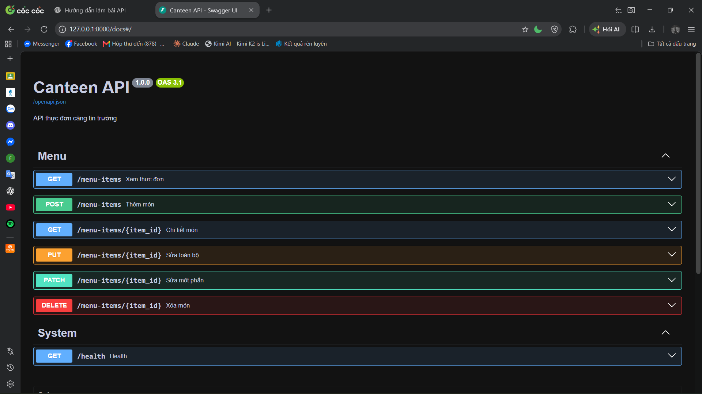
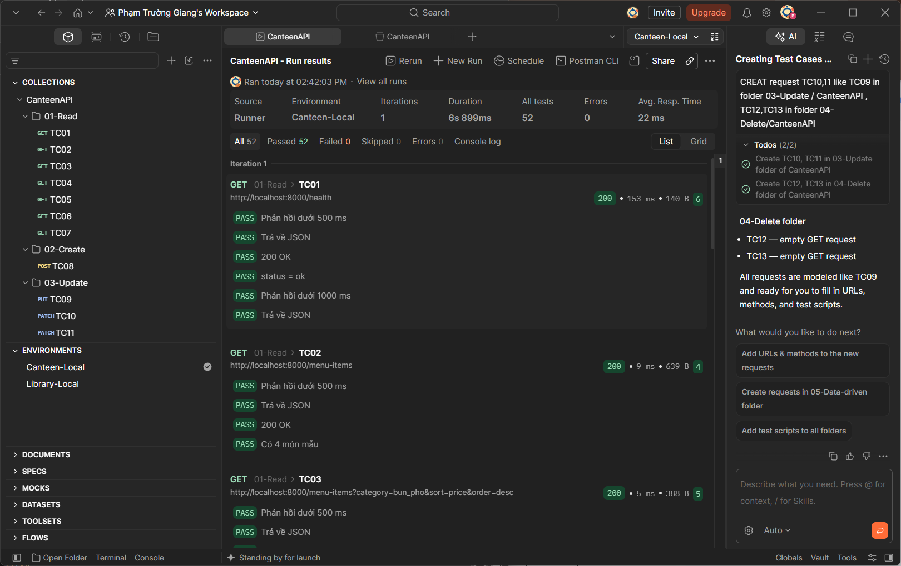
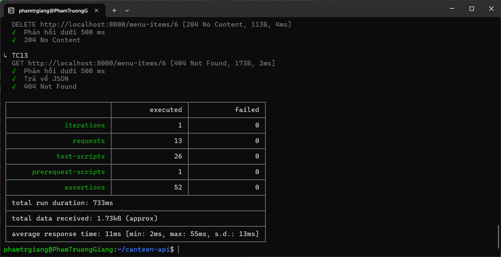

# Canteen API

Bài thực hành: Thiết kế và hiện thực các Endpoint CRUD,
kiểm thử API bằng Postman.

## 1. Công nghệ

- Python
- FastAPI
- Pydantic
- Postman
- Newman
- Git và GitHub

## 2. Chức năng

- GET /menu-items
- GET /menu-items/{id}
- POST /menu-items
- PUT /menu-items/{id}
- PATCH /menu-items/{id}
- DELETE /menu-items/{id}

## 3. Hướng dẫn chạy

Tạo môi trường ảo:

```bash
python3 -m venv .venv
source .venv/bin/activate
```

Cài thư viện:

```bash
pip install -r requirements.txt
```

Khởi chạy ứng dụng:

```bash
python -m uvicorn app.main:app --reload
```

Mở Swagger:

http://127.0.0.1:8000/docs

## 4. Kết quả kiểm thử

- 13 test case trong Postman.
- 6 trường hợp kiểm thử CSV.
- Tự động hóa bằng Newman.

## 5. Minh chứng

### Swagger UI


### Postman Runner


### Newman

